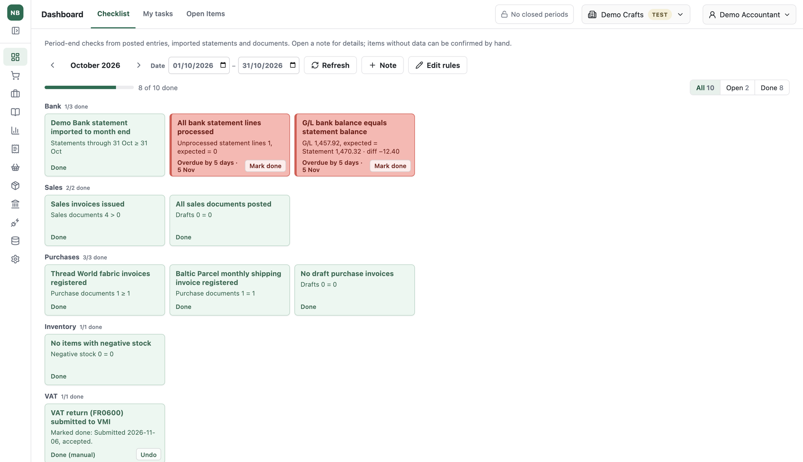
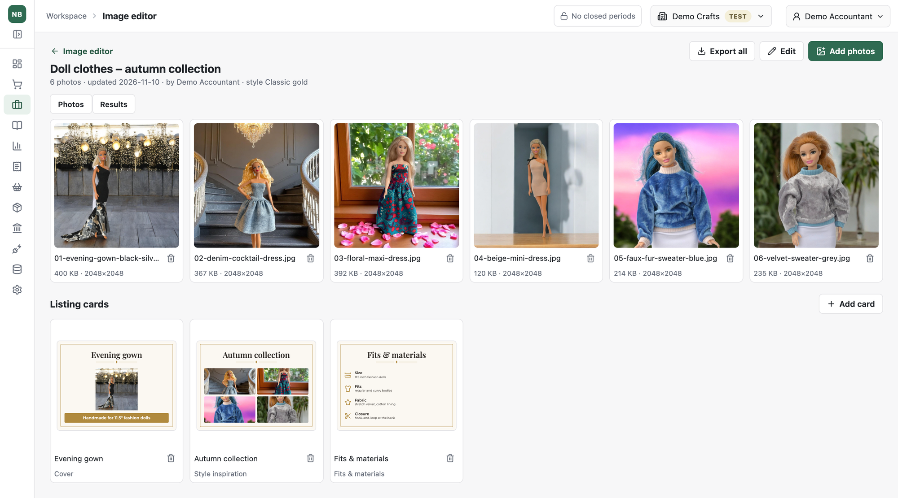
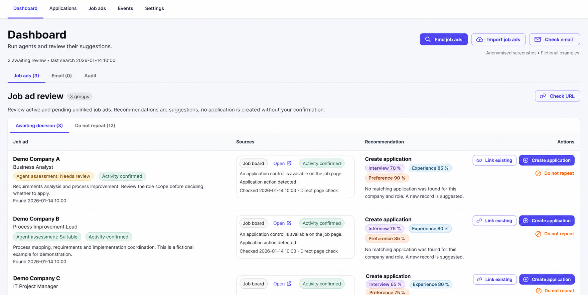

# Neringa Bateikienė

## Systems analysis and hands-on product development

I build applications for work I do myself: bookkeeping for a small e-commerce business, preparing product listings, and managing a job search. My background in ERP systems, finance and e-commerce helps me define how a product should behave, including the exceptions.

**[View the project presentation](presentation/README.md)** · [Download PowerPoint](presentation/Neringa_Bateikiene_Product_Portfolio.pptx?raw=true)

## What I do in these projects

AI coding tools write most of the code. I decide what gets built and whether it is right.

| My part | In practice |
|---|---|
| **Define the problem** | I start from my own working process and map the steps, records and data relationships it needs. |
| **Set the rules** | I define states, business rules, exceptions and acceptance criteria. Accounting values come from settings and mappings, never from code. |
| **Direct the build** | I break work into small, reviewed changes, set priorities and decide between design options. |
| **Test with real work** | I use the applications daily, investigate mismatches and turn each finding into a corrected rule and an automated test. |
| **Protect the data** | I keep each organisation's data separate, give users role-based access and publish only anonymised or fictional data. |

## Explore my projects

### 1. [NB Accounting](projects/nb-accounting/README.md)

**E-commerce bookkeeping built around rules, checklists and clear next actions.**

NB Accounting takes marketplace orders, payments, purchase invoices and bank statements into one bookkeeping workflow. A period checklist shows what is complete and what still needs attention, and every check explains the figures it compares.

*Demonstration organisation with fictional data.*

**My contribution:** the checklist and rule model, the import-review-post workflow, and the VAT, OSS and i.SAF reporting rules. I also designed the inventory and shipping flows and the user permissions.

[Explore the NB Accounting case study](projects/nb-accounting/README.md#see-the-system)

### 2. [Product content studio](projects/product-content-studio/README.md)

**Listing photos, sewing guides and shop texts for a handmade doll-clothes business, without generative AI.**

The studio covers the product side of the same shop. It handles product photos and listing cards, step-by-step sewing guides, and listing texts for each sales channel. A separate tool, Pattern Tracer, turns paper patterns into accurate vector pieces.

*Real product photos from my shop; demonstration organisation.*

**My contribution:** the workflow from photo to listing, and the rules for background removal without AI. I also defined the guide structure and the channel text limits, and the AI-free rules for uploads and exports.

[Explore the Product content studio case study](projects/product-content-studio/README.md#see-the-system)

### 3. [Career CRM](projects/career-crm/README.md)

**A personal workspace for finding opportunities and managing application history.**

Career CRM brings source checks, fit assessments and suggested actions into one review queue. AI helps find opportunities and interpret recruitment emails. The user confirms every change, and event rules keep application statuses and history consistent.

*Anonymised application screenshot, translated into English for presentation.*

**My contribution:** the review-before-record principle for AI suggestions, the application, advertisement and event model, and the status rules.

[Explore the Career CRM case study](projects/career-crm/README.md#see-the-system)

## Technology

All three projects use **Python, FastAPI, PostgreSQL, React, TypeScript and Docker**, with GitHub for version control and automated backend and frontend tests.

These are personal projects under active development. The application repositories are private, and the applications run locally or on a home server. Screenshots use a demonstration organisation with fictional companies, people and amounts.

**Based in Vilnius, Lithuania.**
