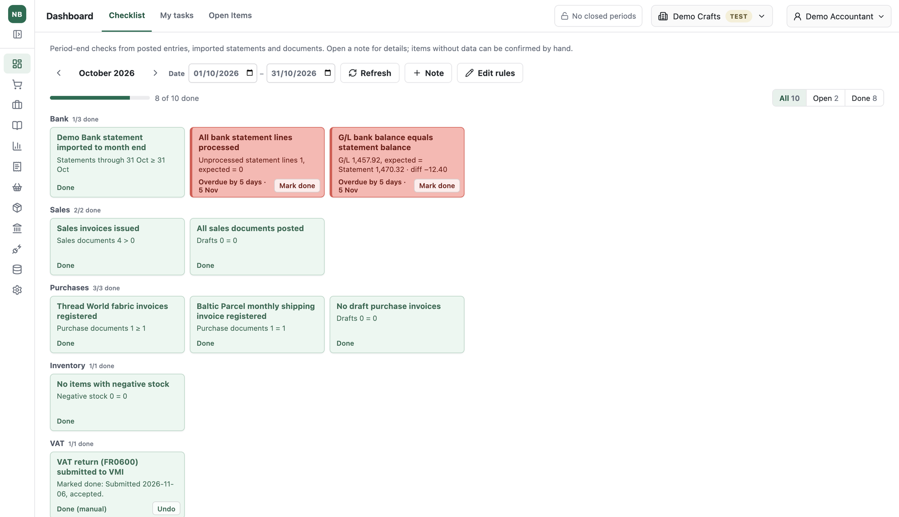
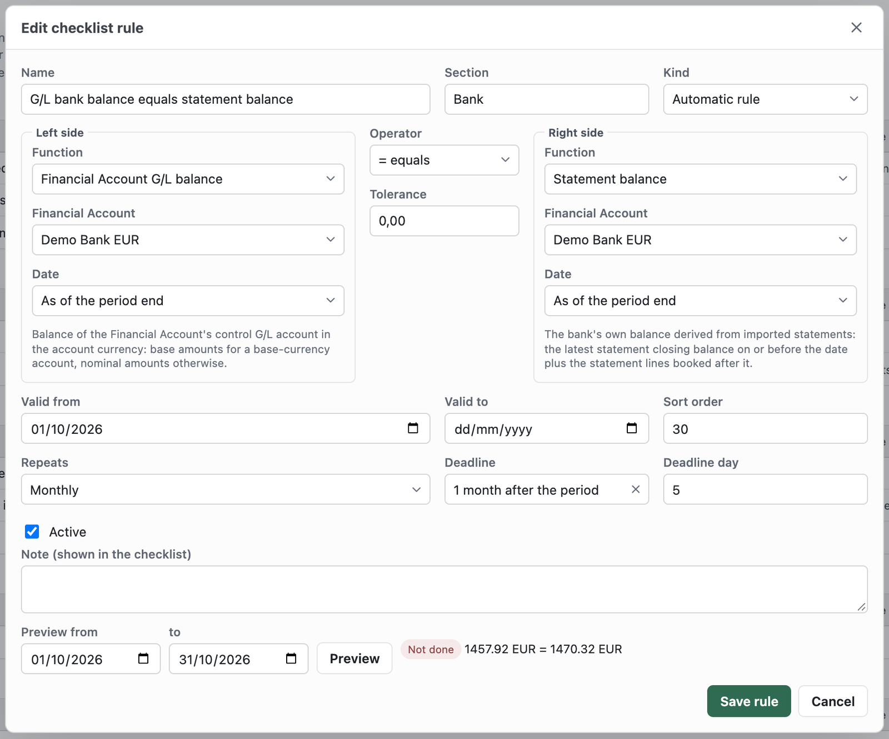
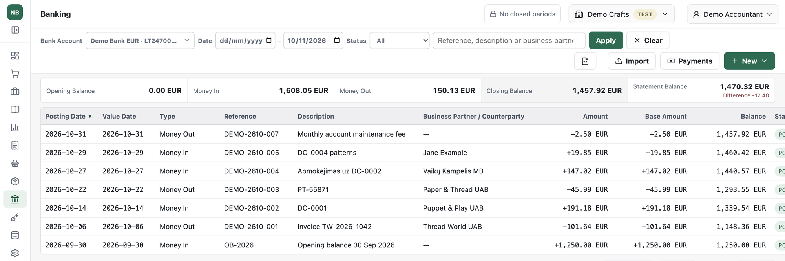
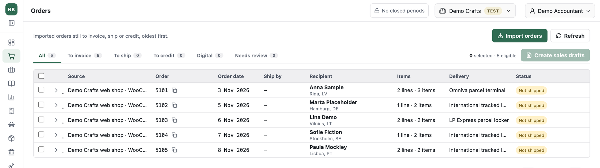
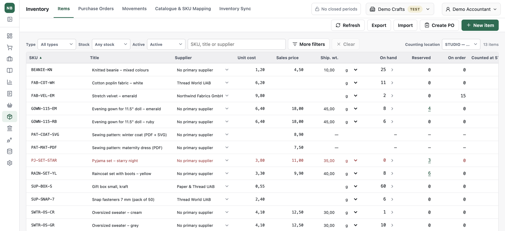
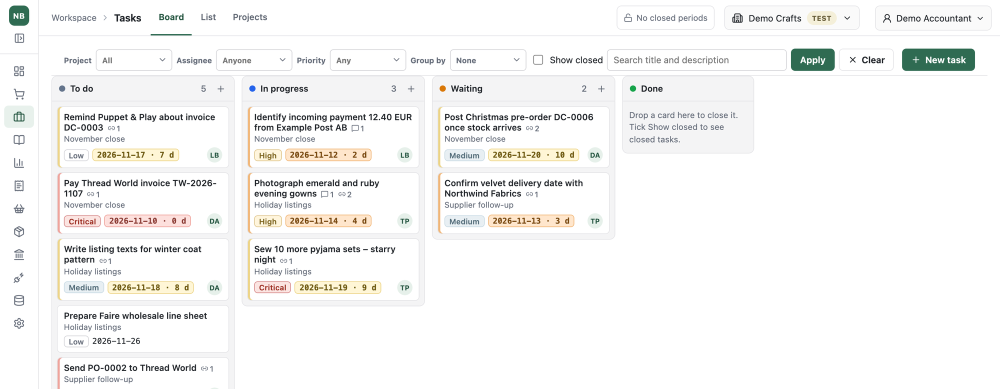
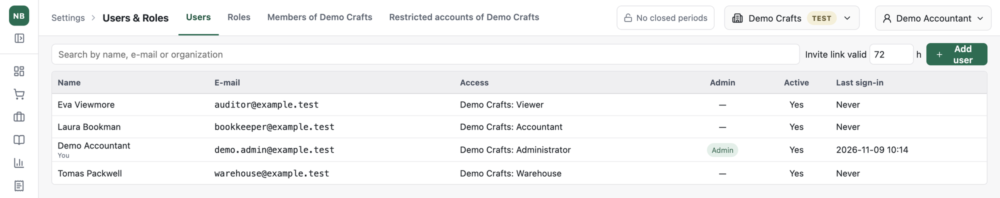

[Back to my portfolio](../../README.md)

# NB Accounting

## E-commerce bookkeeping built around rules, checklists and clear next actions

I started NB Accounting to make my own bookkeeping faster and to stop depending on paid integrations that each covered only part of the work. The shop sells through several marketplaces, takes payments through several providers and ships to many countries. Each of those adds its own documents, fees and VAT treatment.

I work through accounting checklists, so I built the system around that approach. The dashboard brings together period tasks, configurable checks and exceptions that need attention. It shows what is complete, where information is missing and which balances do not match.

**Status:** Personal application under active development, used daily. Source code is private.

## My contribution

| Area | What I defined and decided |
|---|---|
| **Process design** | The path every source record follows: import → review → draft document → posting → reports. Nothing reaches the ledger without a review stage. |
| **Accounting rules** | VAT treatment by date, country and channel, document series by VAT registration, OSS and export cases, credit notes and corrections. Every value comes from settings, mappings or master data, never from code, so another company or another year can use different values. |
| **Controls** | The checklist rule model, period closing and reopening, duplicate detection, and validation of payment files before they leave the system. |
| **Data model** | How orders, sales documents, payments, bank lines, open items and stock movements link to each other, and how to undo a link safely. |
| **Access and isolation** | Users, roles and permission levels (view, edit, reopen) for each area, with every organisation's data kept separate. |
| **Verification** | I test each change against my real records. When something does not match, I describe the expected behaviour, have it corrected and add an automated test. |

## See the system

These screenshots come from a demonstration organisation with fictional companies, people, IBANs and amounts. The screens, rules and results are the application's own.

### 1. Know what needs attention

The period checklist groups checks for banking, sales, purchases, inventory and VAT. Automatic checks read posted entries, imported statements and documents. Manual items, such as confirming a VAT return was submitted, are marked as manual.

October has two open checks. One bank statement line is unprocessed, so the general ledger and the statement differ by **EUR 12.40**. Each card shows the figures behind its result, not just a red flag.

### 2. A check is a rule, not code

A rule compares two functions, or a function with a constant, using an operator and a tolerance. The user chooses the account, the period and the deadline, and previews the result before saving.

The preview shows **1,457.92 EUR = 1,470.32 EUR → Not done**. A missing input gives an unknown result, never a false "done".

### 3. Trace the difference to the record

The bank register shows the same gap: the statement balance is 1,470.32 EUR and the posted balance 1,457.92 EUR. The unprocessed line still has to be matched and posted.

### 4. Orders, stock and work in one place

Imported marketplace orders wait in a worklist until they are invoiced, shipped or credited. Inventory tracks stock on hand, stock reserved by draft orders and stock on order from suppliers. A task board links work to the records it concerns.

### 5. Access by role

Each user gets a role in each organisation. A role sets the level for every area: view, edit, or reopen closed periods.

## Connected workflows

| Area | Current scope |
|---|---|
| Marketplace imports | Etsy, WooCommerce, Faire and Amazon. Source records are reviewed before sales documents are created. |
| Payments and banking | PayPal, Stripe and WooPayments imports, CAMT bank statements with recognition rules, open-item matching with FX differences, and pain.001 payment files. |
| Purchase invoices | Extraction from text-based PDFs, supplier recognition by IBAN, VAT rate checks and duplicate detection before posting. |
| Inventory | Items, locations, purchase orders, reserved and on-order quantities, SKU mapping to channel listings and stock updates to the channels. |
| Shipping | Carrier rate comparison, shipping labels and export evidence for zero-rated sales. |
| Accounting | Sales and purchase documents, credit notes, journal entries, open items, reports and period closing with controlled reopening. |
| Work management | Tasks with projects, priorities, deadlines, comments and links to records; the accounting checklist on the dashboard. |

## Tax reporting workflows

| Workflow | Current scope |
|---|---|
| Lithuania — i.SAF | XML generation, upload to VMI and processing-status tracking. |
| Lithuania — FR0600 | VAT return preparation from posted documents. |
| Union OSS | Quarterly calculation, threshold tracking and corrections in later quarters. |
| Germany — VAT | UStVA preparation and ELSTER XML export; filing is completed in the portal. |
| UK — VAT | Return preparation and an HMRC submission workflow; figures are entered or imported from CSV. |
| EU VAT numbers | VIES checks; a business customer gets 0 % VAT only with a valid number. |

## Product decisions behind the screens

- **Checks should explain their result.** Show the compared values, the period and any missing input. Keep a manual confirmation separate from the automatic result.
- **Imported data needs a review stage.** Resolve mappings and document issues before source records affect the ledger.
- **No accounting constants in code.** Accounts, VAT codes and rates with validity dates, number series, countries and carriers are settings that an accountant can change.
- **Financial controls need clear boundaries.** Posting, period closing, payment-file validation and external submission are separate steps, each with its own checks.

## How I develop and check it

I map the process and data relationships, define the required behaviour, compare the result with that expectation and direct corrections. Each change goes through a written plan, a separate branch, automated tests and an independent review before I merge it. Duplicates, dates, currencies and correction paths get particular attention.

**Technology:** Python, FastAPI, SQLAlchemy, PostgreSQL, React, TypeScript and Docker Compose. Database changes run as idempotent startup migrations.

## A three-minute walkthrough

1. Open the October checklist and pick the open bank check.
2. Open its rule: the two functions, the tolerance and the preview result.
3. Go to the bank register, find the unprocessed line and explain what posting it will change.

The walkthrough uses a fictional organisation. External payments and tax submissions are not part of it.
