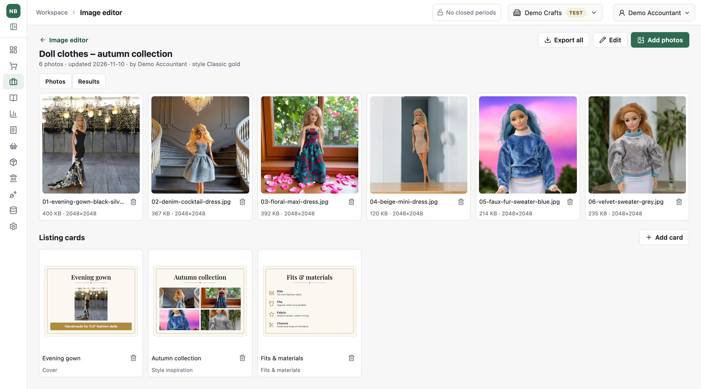
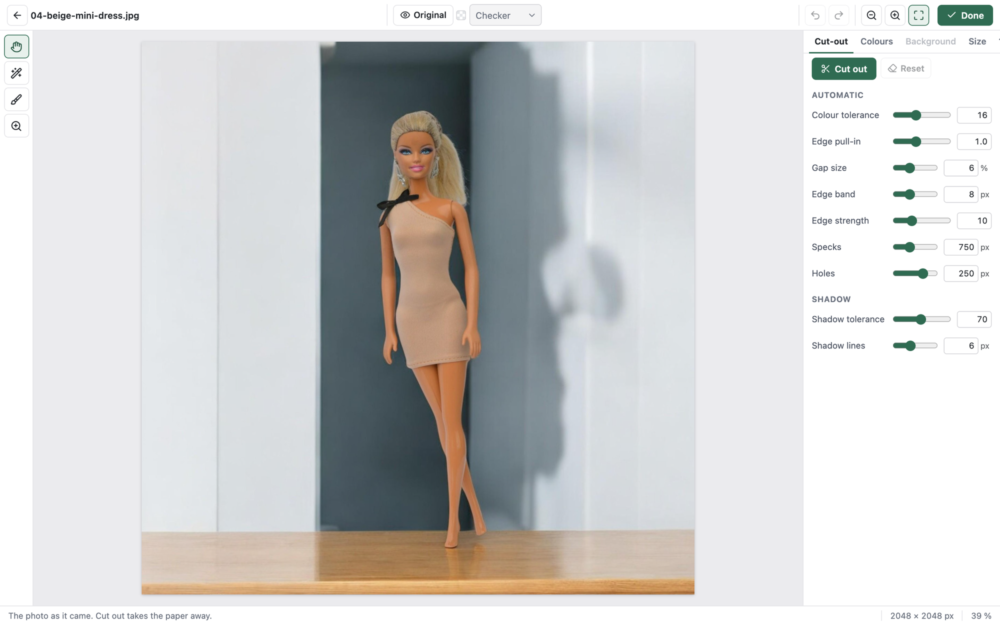
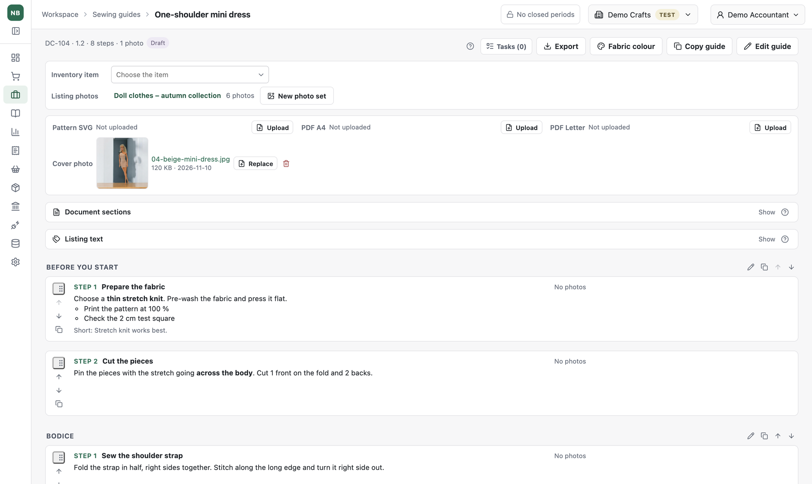
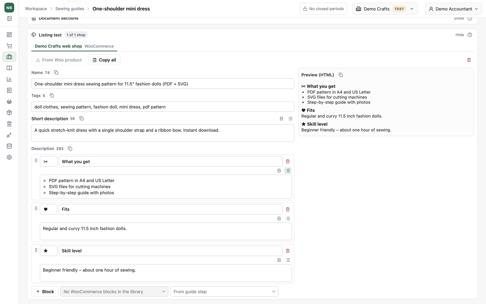
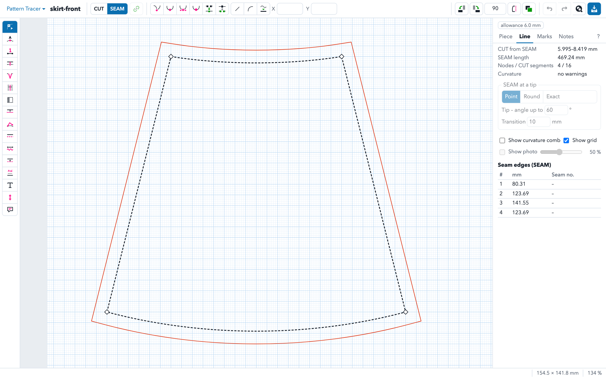

[Back to my portfolio](../../README.md)

# Product content studio

## Listing photos, sewing guides and shop texts, without generative AI

My shop sells handmade doll clothes and digital sewing patterns on Etsy, WooCommerce and Faire. Every product needs consistent listing photos, a printable sewing guide and a listing text that fits each channel's limits. I used to do this in several separate tools, so I built it into NB Accounting's Workspace. The product, its inventory item, its listings and its photos are now linked.

One rule shaped the whole studio: **no generative AI in the product content.** The photos show real products, and buyers should get exactly what they see. AI tools help me write the code. Inside the studio, every edit is an explicit, repeatable operation on the original photo.

**Status:** Personal application under active development, used for my shop. Source code is private.

## My contribution

| Area | What I defined and decided |
|---|---|
| **Workflow** | Photo set → cut-out → light and colour → size → listing cards → export, with batch actions for many photos at once. |
| **Background removal without AI** | How to separate a product from a paper backdrop using colour and edge rules: tolerance, edge band, specks and holes, shadows, and hand tools that the automatic step must not undo. |
| **Provenance rules** | Uploads with an AI-generator mark are refused. Exports carry no editing metadata. Every font, icon and texture is kept with its licence and checksum. |
| **Sewing guides** | Sections and steps that read the same on screen and in print, a reusable block library, guide codes, and DOCX and PDF exports. |
| **Channel texts** | One text per guide and shop, blocks reused from a library or a guide step, and character limits that the organisation can set for each channel. |
| **Pattern Tracer** | The rules for turning a photographed paper pattern into accurate pieces: seam and cut lines, allowances, darts, folds and sizes. |

## See the system

The product photos below come from my shop's public listings. The organisation, guide and listing texts are demonstration data, and the pattern piece is a simple shape drawn for this page, not one of my patterns.

### 1. A photo set and its listing cards

A set holds the photos of one product and the cards made from them: cover, collection, fits and materials, what's included, a scene with several cut-outs, and others. The set's style decides the fonts, colours and ornaments of every card.

### 2. Background removal you can explain

The editor removes a paper backdrop by colour and edge rules, not by a model's guess. Every setting is visible and has a number. Hand tools fix what the automatic step missed, and changing a slider keeps those hand-made changes. Light, colours, background and export size each have their own tab.

The rules are built for photos taken on a plain paper backdrop. A finished listing photo with an interior behind the doll is left as it is rather than cut badly.

### 3. A sewing guide linked to the product

A guide has sections and steps with formatted text, photos, seam and point marks, and optional steps. From the guide page you reach the inventory item, the channel listings, the photo sets and the related tasks. The guide exports to DOCX and PDF in the same order as the screen.

### 4. One listing text for each shop

Each shop gets its own name, tags, short description and description blocks, with a live HTML preview and character counts against that channel's limits. Blocks can come from a shared library or from a guide step, and existing text can be read from the shop's product.

### 5. Pattern Tracer

Pattern Tracer is a separate application. It turns a photographed paper pattern into vector pieces with a seam line, a cut line and allowances. It also handles darts, folds, pleats and sizes, and checks seam lengths. NB Accounting's sewing guides read a product's pieces and marks from it.

## Product decisions behind the screens

- **The original is never lost.** Cut-outs, light changes and sizes are stored as settings on top of the original photo and can be redone.
- **Automatic first, hand last.** A hand correction outranks any later automatic recalculation.
- **Screen equals print.** A guide's order and grouping are the same on screen, in DOCX and in PDF.
- **Limits belong to settings.** Character limits, export sizes, styles and backgrounds are organisation settings, not constants.

## How I develop and check it

I test with my own product photos and patterns. When a result is wrong, I find the photo that shows the problem, describe what a correct result looks like and have the rule changed. The image rules are covered by automated tests on synthetic images, so a fix for one photo cannot quietly break another.

**Technology:** React and TypeScript (canvas and Web Workers for image processing), Python and FastAPI, PostgreSQL, python-docx and ReportLab for exports. Pattern Tracer uses Python with OpenCV, Shapely and SVG tools.
